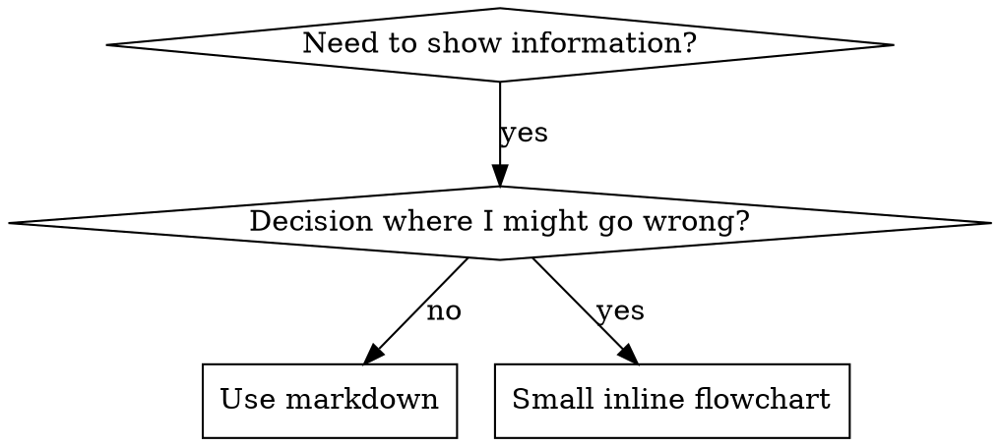

# Escribir skills

## Resumen

**Escribir skills ES Test-Driven Development aplicado a la documentación de procesos.**

**Las skills personales viven en directorios específicos de cada agente (`~/.claude/skills` para Claude Code, `~/.agents/skills/` para Codex)** 

Escribes casos de prueba (escenarios de presión con subagentes), los ves fallar (comportamiento baseline), escribes la skill (documentación), ves pasar las pruebas (los agentes cumplen) y refactorizas (cierras resquicios).

**Principio central:** Si no viste a un agente fallar sin la skill, no sabes si la skill enseña lo correcto.

**CONOCIMIENTO PREVIO REQUERIDO:** **DEBES** entender superpowers:test-driven-development antes de usar esta skill. Esa skill define el ciclo fundamental RED-GREEN-REFACTOR. Esta skill adapta TDD a la documentación.

**Guía oficial:** Para las mejores prácticas oficiales de Anthropic sobre la autoría de skills, consulta anthropic-best-practices.md. Este documento aporta patrones y lineamientos adicionales que complementan el enfoque centrado en TDD de esta skill.

## ¿Qué es una skill?

Una **skill** es una guía de referencia de técnicas, patrones o herramientas probados. Las skills ayudan a futuras instancias de Claude a encontrar y aplicar enfoques efectivos.

**Las skills son:** Técnicas reutilizables, patrones, herramientas, guías de referencia

**Las skills NO son:** Narraciones sobre cómo resolviste un problema una vez

## Correspondencia de TDD para skills

| Concepto de TDD | Creación de skills |
|-------------|----------------|
| **Caso de prueba** | Escenario de presión con subagente |
| **Código de producción** | Documento de la skill (SKILL.md) |
| **La prueba falla (RED)** | El agente viola la regla sin la skill (baseline) |
| **La prueba pasa (GREEN)** | El agente cumple con la skill presente |
| **Refactorizar** | Cerrar resquicios manteniendo el cumplimiento |
| **Escribir la prueba primero** | Ejecutar el escenario baseline ANTES de escribir la skill |
| **Verla fallar** | Documentar las racionalizaciones exactas que usa el agente |
| **Código mínimo** | Escribir la skill atacando esas violaciones específicas |
| **Verla pasar** | Verificar que el agente ahora cumple |
| **Ciclo de refactorización** | Encontrar nuevas racionalizaciones → taparlas → re-verificar |

Todo el proceso de creación de skills sigue RED-GREEN-REFACTOR.

## Cuándo crear una skill

**Créala cuando:**
- La técnica no te resultó intuitivamente obvia
- La volverías a consultar en distintos proyectos
- El patrón aplica de forma amplia (no es específico de un proyecto)
- Otros se beneficiarían

**No la crees para:**
- Soluciones de una sola vez
- Prácticas estándar bien documentadas en otros lugares
- Convenciones específicas del proyecto (ponlas en CLAUDE.md)
- Restricciones mecánicas (si se puede imponer con regex/validación, automatízalo; reserva la documentación para decisiones de criterio)

## Tipos de skills

### Técnica
Método concreto con pasos a seguir (condition-based-waiting, root-cause-tracing)

### Patrón
Forma de pensar sobre los problemas (flatten-with-flags, test-invariants)

### Referencia
Documentación de APIs, guías de sintaxis, documentación de herramientas (office docs)

## Estructura de directorios


```
skills/
  skill-name/
    SKILL.md              # Main reference (required)
    supporting-file.*     # Only if needed
```

**Namespace plano** - todas las skills en un único namespace donde se puede buscar

**Archivos separados para:**
1. **Referencia extensa** (100+ líneas) - documentación de APIs, sintaxis exhaustiva
2. **Herramientas reutilizables** - Scripts, utilidades, plantillas

**Mantén en línea:**
- Principios y conceptos
- Patrones de código (< 50 líneas)
- Todo lo demás

## Estructura de SKILL.md

**Frontmatter (YAML):**
- Dos campos obligatorios: `name` y `description` (consulta [agentskills.io/specification](https://agentskills.io/specification) para ver todos los campos soportados)
- Máximo 1024 caracteres en total
- `name`: Usa solo letras, números y guiones (sin paréntesis ni caracteres especiales)
- `description`: En tercera persona, describe SOLO cuándo usarla (NO lo que hace)
  - Empieza con "Use when..." ("Úsala cuando...") para centrarte en las condiciones de activación
  - Incluye síntomas, situaciones y contextos específicos
  - **NUNCA resumas el proceso o flujo de trabajo de la skill** (consulta la sección CSO para saber por qué)
  - Mantenla por debajo de 500 caracteres si es posible

```markdown
---
name: Skill-Name-With-Hyphens
description: Úsala cuando [condiciones de activación y síntomas específicos]
---

# Nombre de la skill

## Resumen
¿Qué es esto? Principio central en 1-2 oraciones.

## Cuándo usarla
[Diagrama de flujo pequeño en línea SI la decisión no es obvia]

Lista de viñetas con SÍNTOMAS y casos de uso
Cuándo NO usarla

## Patrón central (para técnicas/patrones)
Comparación de código antes/después

## Referencia rápida
Tabla o viñetas para escanear operaciones comunes

## Implementación
Código en línea para patrones simples
Enlace a un archivo para referencia extensa o herramientas reutilizables

## Errores comunes
Qué sale mal + soluciones

## Impacto en el mundo real (opcional)
Resultados concretos
```


## Claude Search Optimization (CSO)

**Crítico para el descubrimiento:** El Claude del futuro necesita ENCONTRAR tu skill

### 1. Campo description rico

**Propósito:** Claude lee la descripción para decidir qué skills cargar para una tarea dada. Haz que responda: "¿Debería leer esta skill ahora mismo?"

**Formato:** Empieza con "Use when..." ("Úsala cuando...") para centrarte en las condiciones de activación

**CRÍTICO: Descripción = Cuándo usarla, NO qué hace la skill**

La descripción SOLO debe describir las condiciones de activación. NO resumas el proceso o flujo de trabajo de la skill en la descripción.

**Por qué importa:** Las pruebas revelaron que cuando una descripción resume el flujo de trabajo de la skill, Claude puede seguir la descripción en lugar de leer el contenido completo de la skill. Una descripción que decía "code review between tasks" hizo que Claude hiciera UNA sola revisión, aunque el diagrama de flujo de la skill mostraba claramente DOS revisiones (cumplimiento de la spec y luego calidad del código).

Cuando la descripción se cambió a solo "Use when executing implementation plans with independent tasks" (sin resumen del flujo de trabajo), Claude leyó correctamente el diagrama de flujo y siguió el proceso de revisión en dos etapas.

**La trampa:** Las descripciones que resumen el flujo de trabajo crean un atajo que Claude tomará. El cuerpo de la skill se convierte en documentación que Claude se salta.

```yaml
# ❌ BAD: Summarizes workflow - Claude may follow this instead of reading skill
description: Use when executing plans - dispatches subagent per task with code review between tasks

# ❌ BAD: Too much process detail
description: Use for TDD - write test first, watch it fail, write minimal code, refactor

# ✅ GOOD: Just triggering conditions, no workflow summary
description: Use when executing implementation plans with independent tasks in the current session

# ✅ GOOD: Triggering conditions only
description: Use when implementing any feature or bugfix, before writing implementation code
```

**Contenido:**
- Usa disparadores, síntomas y situaciones concretos que indiquen que esta skill aplica
- Describe el *problema* (race conditions, comportamiento inconsistente), no *síntomas específicos del lenguaje* (setTimeout, sleep)
- Mantén los disparadores agnósticos a la tecnología, a menos que la skill en sí sea específica de una tecnología
- Si la skill es específica de una tecnología, hazlo explícito en el disparador
- Escribe en tercera persona (se inyecta en el system prompt)
- **NUNCA resumas el proceso o flujo de trabajo de la skill**

```yaml
# ❌ BAD: Too abstract, vague, doesn't include when to use
description: For async testing

# ❌ BAD: First person
description: I can help you with async tests when they're flaky

# ❌ BAD: Mentions technology but skill isn't specific to it
description: Use when tests use setTimeout/sleep and are flaky

# ✅ GOOD: Starts with "Use when", describes problem, no workflow
description: Use when tests have race conditions, timing dependencies, or pass/fail inconsistently

# ✅ GOOD: Technology-specific skill with explicit trigger
description: Use when using React Router and handling authentication redirects
```

### 2. Cobertura de palabras clave

Usa palabras que Claude buscaría:
- Mensajes de error: "Hook timed out", "ENOTEMPTY", "race condition"
- Síntomas: "flaky", "hanging", "zombie", "pollution"
- Sinónimos: "timeout/hang/freeze", "cleanup/teardown/afterEach"
- Herramientas: Comandos reales, nombres de librerías, tipos de archivo

### 3. Nombres descriptivos

**Usa voz activa, con el verbo primero:**
- ✅ `creating-skills` y no `skill-creation`
- ✅ `condition-based-waiting` y no `async-test-helpers`

### 4. Eficiencia de tokens (crítico)

**Problema:** las skills de getting-started y las que se referencian con frecuencia se cargan en CADA conversación. Cada token cuenta.

**Conteos de palabras objetivo:**
- Flujos de trabajo de getting-started: <150 palabras cada uno
- Skills que se cargan con frecuencia: <200 palabras en total
- Otras skills: <500 palabras (igual sé conciso)

**Técnicas:**

**Mueve los detalles a la ayuda de la herramienta:**
```bash
# ❌ BAD: Document all flags in SKILL.md
search-conversations supports --text, --both, --after DATE, --before DATE, --limit N

# ✅ GOOD: Reference --help
search-conversations supports multiple modes and filters. Run --help for details.
```

**Usa referencias cruzadas:**
```markdown
# ❌ MAL: Repetir detalles del flujo de trabajo
Al buscar, despacha un subagente con la plantilla...
[20 líneas de instrucciones repetidas]

# ✅ BIEN: Referenciar otra skill
Usa siempre subagentes (ahorro de contexto de 50-100x). REQUERIDO: Usa [other-skill-name] para el flujo de trabajo.
```

**Comprime los ejemplos:**
```markdown
# ❌ MAL: Ejemplo verboso (42 palabras)
tu compañero humano: "¿Cómo manejamos antes los errores de autenticación en React Router?"
Tú: Buscaré en conversaciones pasadas patrones de autenticación con React Router.
[Despachar subagente con la consulta de búsqueda: "React Router authentication error handling 401"]

# ✅ BIEN: Ejemplo mínimo (20 palabras)
Compañero: "¿Cómo manejamos los errores de auth en React Router?"
Tú: Buscando...
[Despachar subagente → síntesis]
```

**Elimina la redundancia:**
- No repitas lo que está en las skills referenciadas
- No expliques lo que es obvio a partir del comando
- No incluyas varios ejemplos del mismo patrón

**Verificación:**
```bash
wc -w skills/path/SKILL.md
# getting-started workflows: aim for <150 each
# Other frequently-loaded: aim for <200 total
```

**Nombra según lo que HACES o la idea central:**
- ✅ `condition-based-waiting` > `async-test-helpers`
- ✅ `using-skills` y no `skill-usage`
- ✅ `flatten-with-flags` > `data-structure-refactoring`
- ✅ `root-cause-tracing` > `debugging-techniques`

**Los gerundios (-ing) funcionan bien para procesos:**
- `creating-skills`, `testing-skills`, `debugging-with-logs`
- Activos, describen la acción que estás realizando

### 4. Referencias cruzadas a otras skills

**Al escribir documentación que referencia otras skills:**

Usa solo el nombre de la skill, con marcadores explícitos de obligatoriedad:
- ✅ Bien: `**REQUIRED SUB-SKILL:** Use superpowers:test-driven-development`
- ✅ Bien: `**REQUIRED BACKGROUND:** You MUST understand superpowers:systematic-debugging`
- ❌ Mal: `See skills/testing/test-driven-development` (no queda claro si es obligatorio)
- ❌ Mal: `@skills/testing/test-driven-development/SKILL.md` (fuerza la carga, quema contexto)

**Por qué no usar enlaces con @:** La sintaxis `@` fuerza la carga inmediata de los archivos, consumiendo 200k+ de contexto antes de que los necesites.

## Uso de diagramas de flujo



**Usa diagramas de flujo SOLO para:**
- Puntos de decisión no obvios
- Bucles de proceso en los que podrías detenerte demasiado pronto
- Decisiones de "cuándo usar A vs B"

**Nunca uses diagramas de flujo para:**
- Material de referencia → Tablas, listas
- Ejemplos de código → Bloques de Markdown
- Instrucciones lineales → Listas numeradas
- Etiquetas sin significado semántico (step1, helper2)

Consulta @graphviz-conventions.dot para las reglas de estilo de graphviz.

**Visualizar para tu compañero humano:** Usa `render-graphs.js` de este directorio para renderizar los diagramas de flujo de una skill a SVG:
```bash
./render-graphs.js ../some-skill           # Each diagram separately
./render-graphs.js ../some-skill --combine # All diagrams in one SVG
```

## Ejemplos de código

**Un ejemplo excelente vale más que muchos mediocres**

Elige el lenguaje más relevante:
- Técnicas de testing → TypeScript/JavaScript
- Depuración de sistemas → Shell/Python
- Procesamiento de datos → Python

**Buen ejemplo:**
- Completo y ejecutable
- Bien comentado, explicando el POR QUÉ
- Tomado de un escenario real
- Muestra el patrón con claridad
- Listo para adaptar (no una plantilla genérica)

**No:**
- Implementes en 5+ lenguajes
- Crees plantillas para rellenar espacios en blanco
- Escribas ejemplos artificiales

Eres bueno portando código: un gran ejemplo es suficiente.

## Organización de archivos

### Skill autocontenida
```
defense-in-depth/
  SKILL.md    # Everything inline
```
Cuándo: Todo el contenido cabe, no se necesita referencia extensa

### Skill con herramienta reutilizable
```
condition-based-waiting/
  SKILL.md    # Overview + patterns
  example.ts  # Working helpers to adapt
```
Cuándo: La herramienta es código reutilizable, no solo narrativa

### Skill con referencia extensa
```
pptx/
  SKILL.md       # Overview + workflows
  pptxgenjs.md   # 600 lines API reference
  ooxml.md       # 500 lines XML structure
  scripts/       # Executable tools
```
Cuándo: El material de referencia es demasiado grande para ir en línea

## La Ley de Hierro (igual que en TDD)

```
NINGUNA SKILL SIN UNA PRUEBA QUE FALLE PRIMERO
```

Esto aplica a skills NUEVAS Y a EDICIONES de skills existentes.

¿Escribiste la skill antes de probarla? Bórrala. Empieza de nuevo.
¿Editaste la skill sin probarla? Es la misma violación.

**Sin excepciones:**
- Ni para "adiciones simples"
- Ni para "solo agregar una sección"
- Ni para "actualizaciones de documentación"
- No conserves cambios sin probar como "referencia"
- No "adaptes" mientras ejecutas las pruebas
- Borrar significa borrar

**CONOCIMIENTO PREVIO REQUERIDO:** La skill superpowers:test-driven-development explica por qué esto importa. Los mismos principios aplican a la documentación.

## Probar todos los tipos de skills

Los distintos tipos de skills necesitan distintos enfoques de prueba:

### Skills que imponen disciplina (reglas/requisitos)

**Ejemplos:** TDD, verification-before-completion, designing-before-coding

**Prueba con:**
- Preguntas académicas: ¿Entienden las reglas?
- Escenarios de presión: ¿Cumplen bajo estrés?
- Varias presiones combinadas: tiempo + costo hundido + agotamiento
- Identifica las racionalizaciones y agrega contraargumentos explícitos

**Criterio de éxito:** El agente sigue la regla bajo máxima presión

### Skills de técnica (guías prácticas)

**Ejemplos:** condition-based-waiting, root-cause-tracing, defensive-programming

**Prueba con:**
- Escenarios de aplicación: ¿Pueden aplicar la técnica correctamente?
- Escenarios de variación: ¿Manejan los casos borde?
- Pruebas de información faltante: ¿Las instrucciones tienen vacíos?

**Criterio de éxito:** El agente aplica con éxito la técnica a un escenario nuevo

### Skills de patrón (modelos mentales)

**Ejemplos:** reducing-complexity, conceptos de information-hiding

**Prueba con:**
- Escenarios de reconocimiento: ¿Reconocen cuándo aplica el patrón?
- Escenarios de aplicación: ¿Pueden usar el modelo mental?
- Contraejemplos: ¿Saben cuándo NO aplicarlo?

**Criterio de éxito:** El agente identifica correctamente cuándo/cómo aplicar el patrón

### Skills de referencia (documentación/APIs)

**Ejemplos:** Documentación de APIs, referencias de comandos, guías de librerías

**Prueba con:**
- Escenarios de recuperación: ¿Pueden encontrar la información correcta?
- Escenarios de aplicación: ¿Pueden usar correctamente lo que encontraron?
- Pruebas de vacíos: ¿Están cubiertos los casos de uso comunes?

**Criterio de éxito:** El agente encuentra y aplica correctamente la información de referencia

## Racionalizaciones comunes para saltarse las pruebas

| Excusa | Realidad |
|--------|---------|
| "La skill es obviamente clara" | Claro para ti ≠ claro para otros agentes. Pruébala. |
| "Es solo una referencia" | Las referencias pueden tener vacíos y secciones poco claras. Prueba la recuperación. |
| "Probar es excesivo" | Las skills sin probar tienen problemas. Siempre. 15 min de pruebas ahorran horas. |
| "Probaré si surgen problemas" | Problemas = los agentes no pueden usar la skill. Prueba ANTES de desplegar. |
| "Es demasiado tedioso probar" | Probar es menos tedioso que depurar una skill mala en producción. |
| "Estoy seguro de que está bien" | El exceso de confianza garantiza problemas. Prueba de todos modos. |
| "La revisión académica es suficiente" | Leer ≠ usar. Prueba escenarios de aplicación. |
| "No hay tiempo para probar" | Desplegar una skill sin probar desperdicia más tiempo arreglándola después. |

**Todas estas significan: Prueba antes de desplegar. Sin excepciones.**

## Blindar las skills contra la racionalización

Las skills que imponen disciplina (como TDD) necesitan resistir la racionalización. Los agentes son inteligentes y encontrarán resquicios cuando estén bajo presión.

**Nota de psicología:** Entender POR QUÉ funcionan las técnicas de persuasión te ayuda a aplicarlas de forma sistemática. Consulta persuasion-principles.md para ver la base de investigación (Cialdini, 2021; Meincke et al., 2025) sobre los principios de autoridad, compromiso, escasez, prueba social y unidad.

### Cierra cada resquicio de forma explícita

No te limites a enunciar la regla; prohíbe los atajos específicos:

<Bad>
```markdown
¿Escribiste código antes de la prueba? Bórralo.
```
</Bad>

<Good>
```markdown
¿Escribiste código antes de la prueba? Bórralo. Empieza de nuevo.

**Sin excepciones:**
- No lo conserves como "referencia"
- No lo "adaptes" mientras escribes las pruebas
- No lo mires
- Borrar significa borrar
```
</Good>

### Responde a los argumentos de "espíritu vs letra"

Agrega pronto un principio fundamental:

```markdown
**Violar la letra de las reglas es violar el espíritu de las reglas.**
```

Esto corta de raíz toda una clase de racionalizaciones del tipo "estoy siguiendo el espíritu".

### Construye una tabla de racionalizaciones

Captura las racionalizaciones de las pruebas baseline (consulta la sección de pruebas más abajo). Cada excusa que ponen los agentes va en la tabla:

```markdown
| Excusa | Realidad |
|--------|---------|
| "Demasiado simple para probarlo" | El código simple se rompe. La prueba toma 30 segundos. |
| "Lo probaré después" | Las pruebas que pasan de inmediato no prueban nada. |
| "Las pruebas después logran los mismos objetivos" | Pruebas después = "¿qué hace esto?" Pruebas primero = "¿qué debería hacer esto?" |
```

### Crea una lista de señales de alerta

Facilita que los agentes se autoevalúen cuando están racionalizando:

```markdown
## Señales de alerta - DETENTE y empieza de nuevo

- Código antes de la prueba
- "Ya lo probé manualmente"
- "Las pruebas después cumplen el mismo propósito"
- "Se trata del espíritu, no del ritual"
- "Esto es diferente porque..."

**Todas estas significan: Borra el código. Empieza de nuevo con TDD.**
```

### Actualiza el CSO con los síntomas de violación

Agrega a la descripción: los síntomas de cuando estás A PUNTO de violar la regla:

```yaml
description: use when implementing any feature or bugfix, before writing implementation code
```

## RED-GREEN-REFACTOR para skills

Sigue el ciclo de TDD:

### RED: Escribe una prueba que falle (baseline)

Ejecuta un escenario de presión con un subagente SIN la skill. Documenta el comportamiento exacto:
- ¿Qué decisiones tomaron?
- ¿Qué racionalizaciones usaron (textualmente)?
- ¿Qué presiones desencadenaron violaciones?

Esto es "ver fallar la prueba": debes ver lo que los agentes hacen de forma natural antes de escribir la skill.

### GREEN: Escribe la skill mínima

Escribe una skill que ataque esas racionalizaciones específicas. No agregues contenido extra para casos hipotéticos.

Ejecuta los mismos escenarios CON la skill. Ahora el agente debería cumplir.

### REFACTOR: Cierra los resquicios

¿El agente encontró una nueva racionalización? Agrega un contraargumento explícito. Vuelve a probar hasta que sea a prueba de balas.

**Metodología de pruebas:** Consulta @testing-skills-with-subagents.md para ver la metodología de pruebas completa:
- Cómo escribir escenarios de presión
- Tipos de presión (tiempo, costo hundido, autoridad, agotamiento)
- Tapar los huecos de forma sistemática
- Técnicas de meta-testing

## Antipatrones

### ❌ Ejemplo narrativo
"En la sesión 2025-10-03, encontramos que un projectDir vacío causaba..."
**Por qué es malo:** Demasiado específico, no es reutilizable

### ❌ Dilución multilenguaje
example-js.js, example-py.py, example-go.go
**Por qué es malo:** Calidad mediocre, carga de mantenimiento

### ❌ Código en diagramas de flujo
```dot
step1 [label="import fs"];
step2 [label="read file"];
```
**Por qué es malo:** No se puede copiar y pegar, es difícil de leer

### ❌ Etiquetas genéricas
helper1, helper2, step3, pattern4
**Por qué es malo:** Las etiquetas deben tener significado semántico

## DETENTE: Antes de pasar a la siguiente skill

**Después de escribir CUALQUIER skill, DEBES DETENERTE y completar el proceso de despliegue.**

**NO:**
- Crees varias skills en lote sin probar cada una
- Pases a la siguiente skill antes de verificar la actual
- Te saltes las pruebas porque "hacerlo en lote es más eficiente"

**El checklist de despliegue de abajo es OBLIGATORIO para CADA skill.**

Desplegar skills sin probar = desplegar código sin probar. Es una violación de los estándares de calidad.

## Checklist de creación de skills (TDD adaptado)

**IMPORTANTE: Usa TodoWrite para crear todos para CADA elemento del checklist de abajo.**

**Fase RED - Escribe una prueba que falle:**
- [ ] Crea escenarios de presión (3+ presiones combinadas para skills de disciplina)
- [ ] Ejecuta los escenarios SIN la skill - documenta el comportamiento baseline textualmente
- [ ] Identifica patrones en las racionalizaciones/fallas

**Fase GREEN - Escribe la skill mínima:**
- [ ] El nombre usa solo letras, números y guiones (sin paréntesis/caracteres especiales)
- [ ] Frontmatter YAML con los campos obligatorios `name` y `description` (máx. 1024 caracteres; consulta la [spec](https://agentskills.io/specification))
- [ ] La descripción empieza con "Use when..." e incluye disparadores/síntomas específicos
- [ ] La descripción está escrita en tercera persona
- [ ] Palabras clave a lo largo del texto para la búsqueda (errores, síntomas, herramientas)
- [ ] Resumen claro con el principio central
- [ ] Ataca las fallas baseline específicas identificadas en RED
- [ ] Código en línea O enlace a un archivo separado
- [ ] Un ejemplo excelente (no multilenguaje)
- [ ] Ejecuta los escenarios CON la skill - verifica que los agentes ahora cumplen

**Fase REFACTOR - Cierra los resquicios:**
- [ ] Identifica NUEVAS racionalizaciones a partir de las pruebas
- [ ] Agrega contraargumentos explícitos (si es una skill de disciplina)
- [ ] Construye la tabla de racionalizaciones a partir de todas las iteraciones de prueba
- [ ] Crea la lista de señales de alerta
- [ ] Vuelve a probar hasta que sea a prueba de balas

**Controles de calidad:**
- [ ] Diagrama de flujo pequeño solo si la decisión no es obvia
- [ ] Tabla de referencia rápida
- [ ] Sección de errores comunes
- [ ] Sin relatos narrativos
- [ ] Archivos de soporte solo para herramientas o referencia extensa

**Despliegue:**
- [ ] Haz commit de la skill en git y push a tu fork (si está configurado)
- [ ] Considera contribuir de vuelta mediante un PR (si es ampliamente útil)

## Flujo de descubrimiento

Cómo el Claude del futuro encuentra tu skill:

1. **Se encuentra con un problema** ("las pruebas son flaky")
3. **Encuentra la SKILL** (la descripción coincide)
4. **Escanea el resumen** (¿es relevante?)
5. **Lee los patrones** (tabla de referencia rápida)
6. **Carga el ejemplo** (solo al implementar)

**Optimiza para este flujo** - pon los términos de búsqueda pronto y con frecuencia.

## En resumen

**Crear skills ES TDD para la documentación de procesos.**

La misma Ley de Hierro: Ninguna skill sin una prueba que falle primero.
El mismo ciclo: RED (baseline) → GREEN (escribir la skill) → REFACTOR (cerrar resquicios).
Los mismos beneficios: Mejor calidad, menos sorpresas, resultados a prueba de balas.

Si sigues TDD para el código, síguelo para las skills. Es la misma disciplina aplicada a la documentación.
