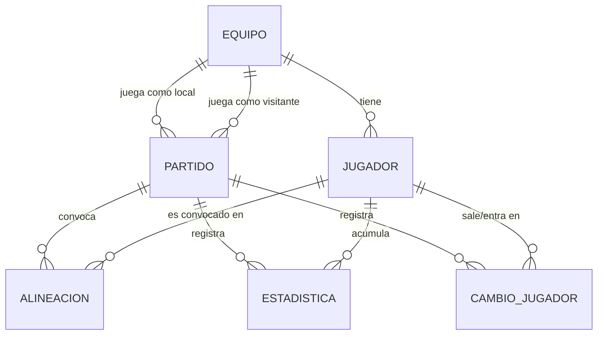

# Documentación del modelo de datos

Este documento describe el modelo de datos de **Más que Amigos**, una aplicación
para gestionar una liga deportiva amateur: equipos, jugadores, partidos,
alineaciones, estadísticas y contenido informativo del sitio.

## Diagrama entidad-relación

## Descripción de los modelos

### 1. Equipo (tabla `equipos`)
Representa un equipo participante en la liga.

**Campos:**
- `id`: identificador único (llave primaria, autoincremental)
- `nombre`: nombre del equipo (máx. 100 caracteres, obligatorio)
- `directorTecnico` (`director_tecnico`): nombre del director técnico (máx. 100 caracteres, obligatorio)
- `imagenUrl` (`imagen_url`): URL del escudo del equipo, servido desde `/uploads/**`
- `titulos`: número de títulos ganados
- `tipoClasificacion` (`tipo_clasificacion`): enum `ELIMINATORIA` | `REPECHAJE`, guardado como texto en BD

**Relaciones:**
- `jugadores`: uno a muchos con Jugador (`mappedBy = "equipo"`, cascada total, `orphanRemoval`)

### 2. Jugador (tabla `jugador`)
Representa un jugador perteneciente a un equipo.

**Campos:**
- `id` (`id_jugador`): identificador único
- `nombre`: nombre del jugador (máx. 100 caracteres, obligatorio)
- `posicion`: enum `PORTERO` | `DEFENSA` | `MEDIOCAMPISTA` | `DELANTERO`
- `edad`: edad del jugador (obligatorio)
- `dorsal`: número de camiseta (obligatorio)
- `imagenUrl` (`imagen_url`): URL de la foto del jugador, servida desde `/uploads/jugadores/**`

**Relaciones:**
- `equipo`: muchos a uno con Equipo (`id_equipo`, obligatorio)

### 3. Partido (tabla `partido`)
Representa un encuentro entre dos equipos.

**Campos:**
- `id` (`id_partido`): identificador único
- `fecha`, `hora`: fecha y hora del partido
- `golesLocal` (`goles_local`), `golesVisitante` (`goles_visitante`): marcador, derivado de los goles registrados en Estadística
- `fase`: enum `FASE_DE_GRUPOS` | `REPECHAJE` | `ELIMINACION_DIRECTA` | `FINAL`
- `estado`: enum `PROGRAMADO` | `EN_CURSO` | `FINALIZADO` (por defecto `PROGRAMADO`; solo cambia vía `PartidoService#iniciarPartido`/`#finalizarPartido`, nunca por edición directa)

**Relaciones:**
- `equipoLocal`, `equipoVisitante`: muchos a uno con Equipo (ambos obligatorios)

### 4. Alineacion (tabla `alineacion`)
Convocatoria de un jugador a un partido específico, con llave compuesta.

**Llave compuesta (`AlineacionId`):** `idPartido` + `idJugador`

**Campos:**
- `titular`: booleano — indica si el jugador inicia como titular o suplente (editable entre partido programado y en curso)

**Relaciones:**
- `partido`, `jugador`: asociaciones de solo lectura (`insertable = false, updatable = false`) hacia los mismos IDs de la llave compuesta

### 5. Estadistica (tabla `estadistica`)
Estadísticas individuales de un jugador en un partido.

**Campos:**
- `id` (`id_estadistica`): identificador único
- `goles`, `tarjetasAmarillas` (`tarjetas_amarillas`), `tarjetasRojas` (`tarjetas_rojas`), `asistencias`: contadores (por defecto 0)
- `minuto`: minuto del partido en que ocurrió, opcional (nulo en registros cargados sin ese dato)

**Relaciones:**
- `jugador`, `partido`: muchos a uno, ambos obligatorios

### 6. CambioJugador (tabla `cambio_jugador`)
Sustitución de un jugador por otro durante un partido. Es un registro de auditoría/bitácora.

**Campos:**
- `id` (`id_cambio_jugador`): identificador único
- `minuto`: minuto del cambio (obligatorio)
- `fechaRegistro` (`fecha_registro`): fecha y hora en que se registró el cambio

**Relaciones:**
- `partido`: muchos a uno, obligatorio
- `jugadorSale` (`id_jugador_sale`), `jugadorEntra` (`id_jugador_entra`): ambos muchos a uno con Jugador, obligatorios

### 7. RegistroInformativo (tabla `registro_informativo`)
Contenido tipo blog mostrado en la página de Inicio, administrado desde Configuración.

**Campos:**
- `id` (`id_registro_informativo`): identificador único
- `titulo`: máx. 150 caracteres, obligatorio
- `contenido`: texto largo (`LONGTEXT` en BD), obligatorio
- `fechaPublicacion` (`fecha_publicacion`): fecha y hora de publicación

### 8. ImagenGaleria (tabla `imagen_galeria`)
Fotos administrables para el carrusel de la página de Inicio.

**Campos:**
- `id` (`id_imagen_galeria`): identificador único
- `imagenUrl` (`imagen_url`): URL de la imagen, obligatorio
- `fechaSubida` (`fecha_subida`): fecha y hora de subida
