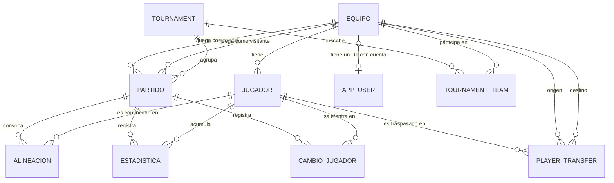

# Documentación del modelo de datos

Este documento describe el modelo de datos de **Más que Amigos**, una aplicación
para gestionar una liga deportiva amateur: equipos, jugadores, partidos,
alineaciones, estadísticas y contenido informativo del sitio.

## Diagrama entidad-relación

## Descripción de los modelos

### 1. Equipo (tabla `equipos`)
Representa un equipo participante en la liga.

**Campos:**
- `id`: identificador único (llave primaria, autoincremental)
- `nombre`: nombre del equipo (máx. 100 caracteres, obligatorio)
- `directorTecnico` (`director_tecnico`): nombre del director técnico (máx. 100 caracteres, obligatorio)
- `imagenUrl` (`imagen_url`): URL del escudo del equipo, servido desde `/uploads/**`
- `titulos`: número de títulos ganados
- `tipoClasificacion` (`tipo_clasificacion`): enum `ELIMINATORIA` | `REPECHAJE`, guardado como texto en BD

**Relaciones:**
- `jugadores`: uno a muchos con Jugador (`mappedBy = "equipo"`, cascada total, `orphanRemoval`)

### 2. Jugador (tabla `jugador`)
Representa un jugador perteneciente a un equipo.

**Campos:**
- `id` (`id_jugador`): identificador único
- `nombre`: nombre del jugador (máx. 100 caracteres, obligatorio)
- `posicion`: enum `PORTERO` | `DEFENSA` | `MEDIOCAMPISTA` | `DELANTERO`
- `edad`: edad del jugador (obligatorio)
- `dorsal`: número de camiseta (obligatorio)
- `imagenUrl` (`imagen_url`): URL de la foto del jugador, servida desde `/uploads/jugadores/**`
- `costo`: valor del jugador (`DECIMAL(12,2)`, `>= 0`, sin divisa; por defecto 0). Es el monto que se copia al solicitar un traspaso

**Relaciones:**
- `equipo`: muchos a uno con Equipo (`id_equipo`, obligatorio). El equipo de un jugador solo cambia mediante un traspaso confirmado (ver `PlayerTransfer`)

**Notas:**
- Un jugador con alineaciones, estadísticas o traspasos registrados no se puede eliminar (restricción de llave foránea; no hay `ON DELETE CASCADE`).
- Al confirmar un traspaso el jugador conserva sus estadísticas históricas, pero sus alineaciones de partidos ya programados con el equipo anterior no se modifican.

### 3. Partido (tabla `partido`)
Representa un encuentro entre dos equipos.

**Campos:**
- `id` (`id_partido`): identificador único
- `fecha`, `hora`: fecha y hora del partido
- `golesLocal` (`goles_local`), `golesVisitante` (`goles_visitante`): marcador, derivado de los goles registrados en Estadística
- `fase`: enum `FASE_DE_GRUPOS` | `REPECHAJE` | `ELIMINACION_DIRECTA` | `FINAL`
- `estado`: enum `PROGRAMADO` | `EN_CURSO` | `FINALIZADO` (por defecto `PROGRAMADO`; solo cambia vía `PartidoService#iniciarPartido`/`#finalizarPartido`, nunca por edición directa)

**Relaciones:**
- `equipoLocal`, `equipoVisitante`: muchos a uno con Equipo (ambos obligatorios)
- `torneo` (`id_torneo`): muchos a uno con Tournament, obligatorio. Todo partido pertenece a un torneo; si al crearlo no se indica, queda en el torneo "Histórico". No cambia durante la vida del partido. La columna lleva el nombre en español porque sigue el idioma de la tabla `partido`

**Notas:**
- No hay bandera de "partido manual": un partido armado a mano en un torneo es una fila más, con el mismo ciclo de vida y la misma puntuación que cualquier otro.

### 4. Alineacion (tabla `alineacion`)
Convocatoria de un jugador a un partido específico, con llave compuesta.

**Llave compuesta (`AlineacionId`):** `idPartido` + `idJugador`

**Campos:**
- `titular`: booleano — indica si el jugador inicia como titular o suplente (editable entre partido programado y en curso)

**Relaciones:**
- `partido`, `jugador`: asociaciones de solo lectura (`insertable = false, updatable = false`) hacia los mismos IDs de la llave compuesta

### 5. Estadistica (tabla `estadistica`)
Estadísticas individuales de un jugador en un partido.

**Campos:**
- `id` (`id_estadistica`): identificador único
- `goles`, `tarjetasAmarillas` (`tarjetas_amarillas`), `tarjetasRojas` (`tarjetas_rojas`), `asistencias`: contadores (por defecto 0)
- `minuto`: minuto del partido en que ocurrió, opcional (nulo en registros cargados sin ese dato)

**Relaciones:**
- `jugador`, `partido`: muchos a uno, ambos obligatorios

### 6. CambioJugador (tabla `cambio_jugador`)
Sustitución de un jugador por otro durante un partido. Es un registro de auditoría/bitácora.

**Campos:**
- `id` (`id_cambio_jugador`): identificador único
- `minuto`: minuto del cambio (obligatorio)
- `fechaRegistro` (`fecha_registro`): fecha y hora en que se registró el cambio

**Relaciones:**
- `partido`: muchos a uno, obligatorio
- `jugadorSale` (`id_jugador_sale`), `jugadorEntra` (`id_jugador_entra`): ambos muchos a uno con Jugador, obligatorios

### 7. RegistroInformativo (tabla `registro_informativo`)
Contenido tipo blog mostrado en la página de Inicio, administrado desde Configuración.

**Campos:**
- `id` (`id_registro_informativo`): identificador único
- `titulo`: máx. 150 caracteres, obligatorio
- `contenido`: texto largo (`LONGTEXT` en BD), obligatorio
- `fechaPublicacion` (`fecha_publicacion`): fecha y hora de publicación

### 8. ImagenGaleria (tabla `imagen_galeria`)
Fotos administrables para el carrusel de la página de Inicio.

**Campos:**
- `id` (`id_imagen_galeria`): identificador único
- `imagenUrl` (`imagen_url`): URL de la imagen, obligatorio
- `fechaSubida` (`fecha_subida`): fecha y hora de subida

### 9. PlayerTransfer (tabla `player_transfer`)
Solicitud de traspaso de un jugador de su equipo actual a otro equipo. Cada fila es parte del historial: el costo es una copia del `costo` del jugador al momento de solicitarla y no cambia si luego se edita el jugador. Tabla y columnas nuevas, por eso van en inglés.

**Campos:**
- `id`: identificador único
- `cost`: costo del jugador al solicitar el traspaso (`DECIMAL(12,2)`)
- `status`: enum `PENDING` | `CONFIRMED` | `REJECTED`, guardado como texto en BD
- `destinationDorsal` (`destination_dorsal`): dorsal nuevo en el equipo destino, opcional (si es nulo se conserva el del jugador)
- `requestedAt` (`requested_at`): fecha y hora de la solicitud
- `resolvedAt` (`resolved_at`): fecha y hora en que se confirmó o rechazó; nulo mientras está `PENDING`

**Relaciones:**
- `player` (`player_id`): muchos a uno con Jugador, obligatorio
- `originTeam` (`origin_team_id`), `destinationTeam` (`destination_team_id`): muchos a uno con Equipo, ambos obligatorios

**Reglas:**
- Pueden coexistir varias solicitudes `PENDING` para el mismo jugador.
- Al confirmar una, el jugador pasa al equipo destino y las demás `PENDING` del mismo jugador pasan a `REJECTED` en la misma transacción (no se borran: quedan como registro y salen de la bandeja de pendientes).
- El historial de equipos de un jugador son sus traspasos `CONFIRMED`.
- Índices: `(player_id, status)` y `status`.

### 10. AppUser (tabla `app_user`)
Cuenta para iniciar sesión. Tabla nueva, por eso va en inglés. La crea un administrador (o el sistema, para el administrador inicial); no hay auto-registro.

**Campos:**
- `id`: identificador único
- `username`: usuario para iniciar sesión (3 a 50 caracteres: letras, números, punto, guion y guion bajo), único. Se guarda siempre en minúsculas y la comparación no distingue mayúsculas
- `passwordHash` (`password_hash`): contraseña protegida con BCrypt; nunca se guarda ni se devuelve en claro
- `role`: enum `ADMIN` | `DT`, guardado como texto en BD. El visitante no tiene cuenta ni rol
- `createdAt` (`created_at`): fecha y hora de creación

**Relaciones:**
- `team` (`team_id`): muchos a uno con Equipo, opcional y **único**. Un DT tiene como máximo un equipo y un equipo tiene como máximo una cuenta. Una cuenta `DT` puede estar sin equipo (por ejemplo, mientras espera la aprobación del que solicitó) y una cuenta `ADMIN` nunca tiene equipo

**Reglas:**
- El administrador inicial se crea al arrancar con `APP_SECURITY_ADMIN_USERNAME` y `APP_SECURITY_ADMIN_PASSWORD`, solo si no existe ya; nunca se modifica una cuenta existente.
- El texto `Equipo.directorTecnico` no se sincroniza con la cuenta del DT: lo mantiene el administrador.
- El equipo del DT se consulta siempre en esta tabla (no en el token de sesión), porque puede asignarse después de iniciar sesión.

### 11. Tournament (tabla `tournament`)
Competencia con un formato de juego definido antes de iniciar y un conjunto de equipos inscritos. Tabla nueva, por eso va en inglés. Todo partido pertenece a un torneo.

**Campos:**
- `id`: identificador único
- `name`: nombre del torneo (3 a 100 caracteres), único sin distinguir mayúsculas
- `format`: enum `LEAGUE` (liga) | `GROUPS_KNOCKOUT` (fase de grupos y eliminatoria) | `KNOCKOUT` (eliminatoria directa) | `LEGACY`, guardado como texto en BD. `LEGACY` es interno: solo rotula el torneo "Histórico" y no se puede elegir por el API
- `status`: enum `DRAFT` | `IN_PROGRESS` | `FINISHED`, guardado como texto en BD
- `createdAt` (`created_at`): fecha y hora de creación
- `startedAt` (`started_at`): fecha y hora de inicio; nulo mientras está en `DRAFT`

**Reglas:**
- Ciclo de vida lineal `DRAFT` → `IN_PROGRESS` → `FINISHED`, sin retrocesos.
- Nombre y formato se pueden cambiar, y el torneo se puede eliminar, solo en `DRAFT`. Al iniciarlo (mínimo 2 equipos inscritos) el formato y las inscripciones quedan bloqueados.
- Solo un torneo `IN_PROGRESS` admite partidos nuevos. Para finalizarlo, todos sus partidos deben estar `FINALIZADO` (un partido aplazado se juega o se elimina antes).
- **Torneo "Histórico"**: lo crea la migración `V9` (formato `LEGACY`, estado `IN_PROGRESS`) y recibe todos los partidos que existían antes de los torneos y los que se crean sin indicar torneo. Está protegido (no se edita, elimina, inicia ni finaliza) y no usa inscripción de equipos.
- Las operaciones que cambian el estado o dependen de él leen el torneo con bloqueo pesimista de fila, para que, por ejemplo, un partido no se cree justo cuando el torneo se finaliza.
- **Liga (`LEAGUE`)**: la tabla de posiciones y la jornada **no se guardan**. La tabla se calcula en cada consulta desde los partidos `FINALIZADO` del torneo (marcador de `partido`) y las tarjetas de `estadistica`; la jornada de un calendario generado equivale a la fecha del partido. No hay tablas ni columnas nuevas para esto. Las tarjetas se atribuyen al equipo actual del jugador (`jugador.equipo`), igual que los goles por equipo, así que un traspaso posterior mueve su historial.

### 12. TournamentTeam (tabla `tournament_team`)
Inscripción de un equipo en un torneo. Tabla nueva, en inglés.

**Campos:**
- `id`: identificador único
- `enrolledAt` (`enrolled_at`): fecha y hora de la inscripción

**Relaciones:**
- `tournament` (`tournament_id`): muchos a uno con Tournament, obligatorio
- `team` (`team_id`): muchos a uno con Equipo, obligatorio

**Reglas:**
- Restricción única `(tournament_id, team_id)`: un equipo se inscribe una sola vez por torneo, pero puede estar inscrito en varios torneos a la vez.
- Se agrega o retira solo mientras el torneo está en `DRAFT`. Retirar quita solo la inscripción de ese torneo; el equipo no se elimina.
- Un equipo inscrito no se puede eliminar (restricción de llave foránea), igual que ya ocurre con los equipos que tienen partidos.
